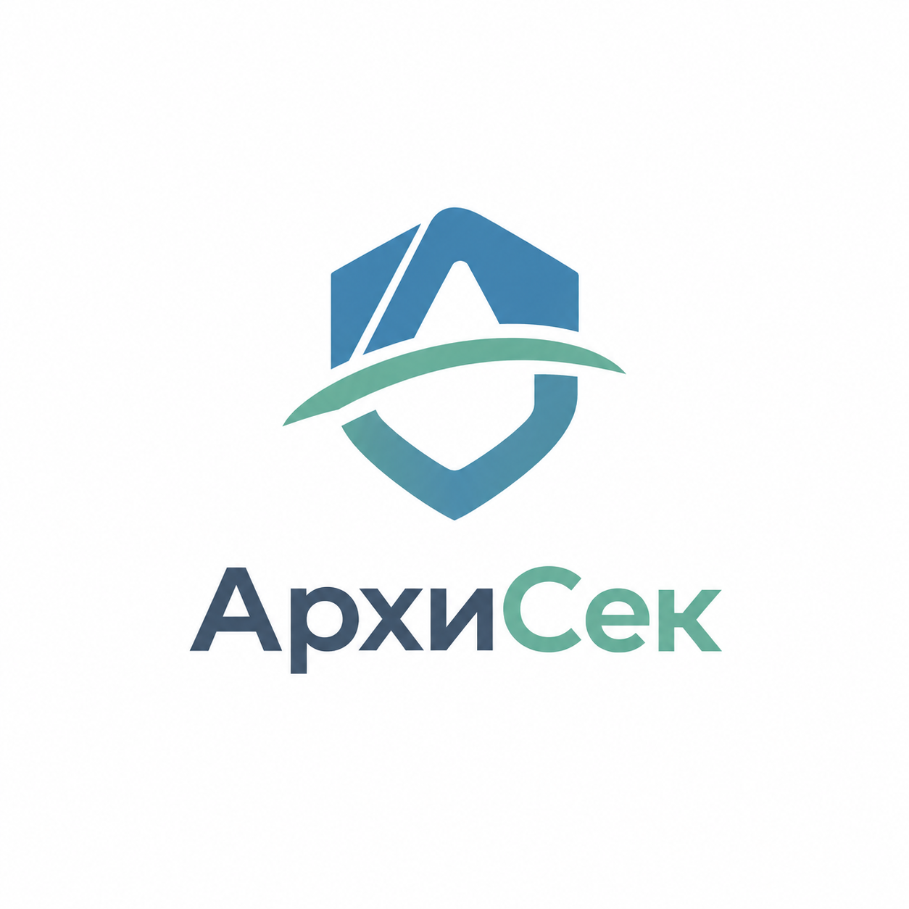

# АрхиСек — OpenCode Orchestra v2.2



Готовый MVP-репозиторий и orchestration layer для разработки «АрхиСек».

## Что уже есть

- минимальный Django 5.2+ проект;
- запуск без БД, ORM и migrations;
- demo JSON data;
- canonical mappings + reverse indexes;
- profile analyzer;
- HTML UI;
- JSON API;
- smoke tests;
- OpenCode V2 agents;
- документация продукта, MVP и архитектуры.

## Важно про модели OpenCode

В `opencode.json` нет общего model override, но в `.opencode/agents/*.md` уже включены активные `model:` настройки: `codexsale/gpt-6.1-sol` для orchestrator/architect/reviewer/backend, `codexsale/glm-5.3` для frontend/qa и `codexsale/glm-5.3-flash` для data. Эти IDs подтверждены текущим каталогом OpenCode 2026-09-30; routing не менялся.

Перед намеренной сменой routing или переносом в другое provider setup проверьте доступность IDs:

```bash
opencode models
```

Для текущего окружения добавлять или раскомментировать model lines не требуется. Источник истины — `.opencode/agents/*.md`; описание назначений — [docs/model_routing.md](docs/model_routing.md). Не подставляйте вымышленные provider/model IDs.

Subagent использует явно настроенную модель, а без override наследует модель родительской сессии. Primary session хранит выбранную модель отдельно: выбор primary agent по ID не переключает её автоматически. Формат model ID в V2 — `provider/model-id` (с опциональным `#variant`). Официальная документация: https://opencode.ai/v2/docs/agents

## Запуск MVP

```bash
python -m venv .venv
# активировать .venv
pip install -r requirements.txt
python manage.py check
python manage.py runserver
```

Не выполняйте `migrate`: MVP не использует БД.

Откройте `http://127.0.0.1:8000/`.

## Интерфейс и фирменный стиль

Русские подписи и названия отображаются отдельно от машинных значений: JSON API, коды сущностей, категории анализа и значения формы не переводятся. Исходный пользовательский логотип находится в `static/img/archisec-logo.png` и используется без изменения дизайна и пропорций. Фирменные цвета `#6AAF9C` и `#4182AE` заданы едиными CSS-переменными; для небольшого текста и интерактивных элементов используются контрастные производные оттенки. Подробности — [docs/branding.md](docs/branding.md).

## OpenCode

Запускайте OpenCode из корня этого репозитория. Первым агентом является `orchestrator`.

Он должен сначала прочитать `docs/` и затем использовать специализированных subagents.

## Фазы

MVP — первая фаза того же проекта. Следующие фазы могут добавить PostgreSQL, ORM, authentication, официальные данные, экспорт и другие production-функции через repository/service boundaries.
